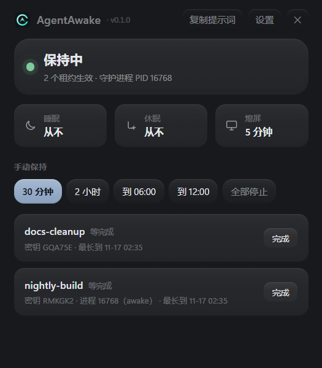

# AgentAwake

<p align="center">
  
</p>

让 Windows 在 agent 干活期间**不睡眠**，屏幕照常自然熄灭。

多个 agent 同时申请互不干扰：**全部结束**才恢复你原来的电源设置。
纯 Go 实现（CLI + 托盘面板），无脚本、无弹窗、空闲时几乎零 CPU。

## 工作方式

| 谁用 | 命令 | 结束条件 |
|---|---|---|
| **agent**（推荐） | `awake acquire -name 任务名 -followpid 进程号` | 它主动 `release`，或绑定的进程退出；另有最长时限兜底 |
| 人 | `awake hold -for 30m` / `awake hold -until 06:00` | 到点自动结束 |

每张租约返回一个 6 位**短密钥**，agent 用它只释放自己的租约——
多个 agent 并行工作时不会误伤别人。

<p align="center">
  
</p>

## 快速开始

从 [Releases](https://github.com/Tribbtsz/AgentAwake/releases/latest) 下载
`AgentAwake-vX.Y.Z.zip`，解压到任意目录，双击 `panel.exe`（托盘常驻）。

- **命令行**（agents 用）：

```powershell
# 绑定自身进程：进程被杀/崩溃也会自动释放
$lease = awake acquire -name "nightly-build" -followpid $PID -json | ConvertFrom-Json
# ...干活...
awake release -key $lease.key     # 只释放自己的租约（推荐）
```

- **手动保持**：面板按钮，或 `awake hold -for 30m`
- **查看状态**：面板 / 托盘 / `awake status`（`-json` 给程序用）
- **查看日志**：面板「日志」页（申请/释放/手动停止/守护进程事件实时滚动），或托盘「打开日志」
- **全部停止**：面板「全部停止」或 `awake stop`

时间写法：`30m` `90s` `2h` `1.5d` `30分钟` `2小时` `06:00` `2026-11-15T06:00`

## 面板

托盘左键打开；任务栏空白区有一颗任务胶囊（`● 保持中 租约 N`，保持中泛绿呼吸，
点击打开面板）。面板内可调：胶囊位置与显示、agent 最长保持（1–24 小时兜底）、
呼吸开关、给 agent 复制的接入提示词。标题栏「日志」页实时展示事件流
（申请/释放/手动停止/守护进程动作），每行右侧悬浮可复制单条日志。

## 从源码构建

需要 Go 1.27+（仅 Windows）：

```bat
build.cmd
```

产物为根目录 `awake.exe` + `panel.exe`，版本号用 `build.cmd v0.1.0` 注入。

## 测试

```powershell
cd cli;   go test ./...
cd panel; go test ./...
```

## 设计与实现

租约模型、守护进程、任务栏胶囊的原生绘制、电源快照的恢复与自愈等细节见
[docs/design.md](docs/design.md)。

## 许可

[MIT](LICENSE)
